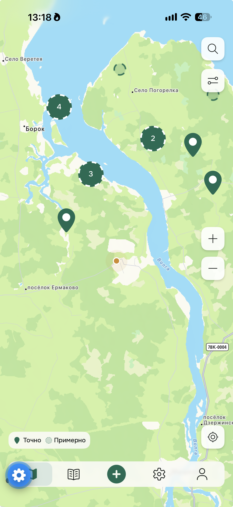
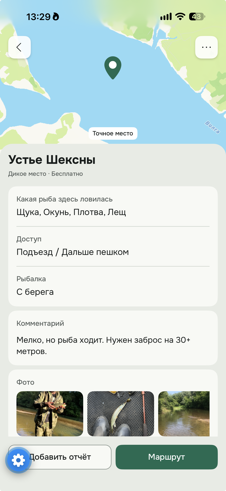
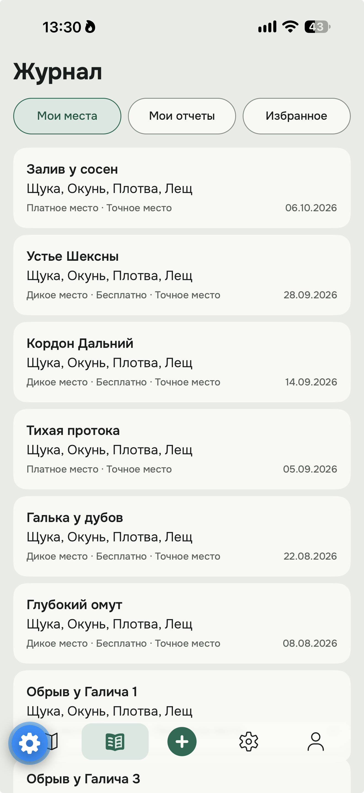

# Клюёт — приложение для рыбаков

**Клюёт** — мобильное приложение для рыбаков, которое помогает находить места для рыбалки, делиться опытом и сохранять любимые локации.

В основе приложения — интерактивная карта с рыболовными точками и отчётами пользователей. Главная идея — помогать рыбакам находить интересные места на основе реального опыта, а не абстрактных рейтингов.

## Возможности MVP 0.1

- **Интерактивная карта** — просмотр рыболовных мест, маркеров и кластеров.
- **Поиск** — поиск населённых пунктов и географических объектов на карте.
- **Добавление мест** — создание рыболовных точек с описанием, видами рыбы и настройками точности координат.
- **Отчёты о рыбалке** — публикация улова с фотографиями, снастями, датой и комментариями.
- **Личный журнал** — просмотр собственных мест и отчётов.
- **Избранное** — сохранение интересных рыболовных мест.
- **Фильтрация** — поиск мест по типу рыбы.
- **Темы оформления** — светлая и тёмная темы интерфейса.

## Технологии

- React Native
- Expo SDK 58
- TypeScript
- Expo Router
- React Native Maps
- AsyncStorage
- Photon API — географический поиск

## Дизайн

Интерфейс разработан в Figma на основе собственной дизайн-системы **K-DS**.

В основе UX — карта как главный экран, минимум лишних действий и удобство использования непосредственно на рыбалке.

## Статус проекта

**MVP 0.1 — демонстрационная версия.**

Приложение разработано в рамках курсового проекта по вайбкодингу. Основные пользовательские сценарии реализованы и протестированы на iOS.

В следующих версиях планируются авторизация, серверное хранение данных, синхронизация между пользователями и развитие социальных возможностей.


## Скриншоты приложения

<p align="center">
  
  
  
</p>

## Автор

Дмитрий Дружков — концепция, продуктовый дизайн, UX/UI и разработка с использованием AI-инструментов.

[Портфолио](https://dopler.lineband.ru)


# Welcome to your Expo app 👋

This is an [Expo](https://expo.dev) project created with [`create-expo-app`](https://www.npmjs.com/package/create-expo-app).

## Get started

1. Install dependencies

   ```bash
   npm install
   ```

2. Start the app

   ```bash
   npx expo start
   ```

In the output, you'll find options to open the app in a

- [development build](https://docs.expo.dev/develop/development-builds/introduction/)
- [Android emulator](https://docs.expo.dev/workflow/android-studio-emulator/)
- [iOS simulator](https://docs.expo.dev/workflow/ios-simulator/)
- [Expo Go](https://expo.dev/go), a limited sandbox for trying out app development with Expo

You can start developing by editing the files inside the **app** directory. This project uses [file-based routing](https://docs.expo.dev/router/introduction).

## Get a fresh project


### Other setup steps

- To set up ESLint for linting, run `npx expo lint`, or follow our guide on ["Using ESLint and Prettier"](https://docs.expo.dev/guides/using-eslint/)
- If you'd like to set up unit testing, follow our guide on ["Unit Testing with Jest"](https://docs.expo.dev/develop/unit-testing/)
- Learn more about the TypeScript setup in this template in our guide on ["Using TypeScript"](https://docs.expo.dev/guides/typescript/)

## Learn more

To learn more about developing your project with Expo, look at the following resources:

- [Expo documentation](https://docs.expo.dev/): Learn fundamentals, or go into advanced topics with our [guides](https://docs.expo.dev/guides).
- [Learn Expo tutorial](https://docs.expo.dev/tutorial/introduction/): Follow a step-by-step tutorial where you'll create a project that runs on Android, iOS, and the web.

## Join the community

Join our community of developers creating universal apps.

- [Expo on GitHub](https://github.com/expo/expo): View our open source platform and contribute.
- [Discord community](https://chat.expo.dev): Chat with Expo users and ask questions.
