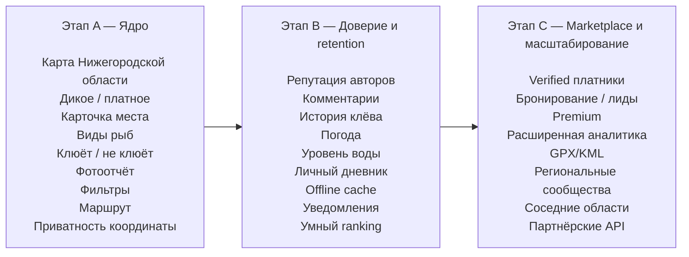

# Российские сервисы для рыбаков: конкурентный анализ и рекомендации для MVP по Нижегородской области

## Executive summary

На российском рынке уже есть сервисы, закрывающие **отдельные части** вашей идеи: карты рыболовных мест, пользовательские отчёты, прогноз клёва, дневники уловов, каталоги платников и рыболовные сообщества. Но в исследованной выборке я не нашёл зрелого продукта, который одновременно хорошо решает пять задач: **актуальная UGC-карта → понятное разделение «дикое/платное» → рейтинг конкретного места → данные о реально пойманной там рыбе → защита секретных точек**. Это и выглядит главным продуктовым окном для MVP. citeturn16view0turn13search30turn21view3turn21view2

Главный конкурент именно для Нижегородской области — не мобильное приложение, а **«Рыболов NN»**. У него уже есть карта и большая база рыболовных мест региона, сведения о рыбе, снастях, подъезде, отдельный каталог баз и платников и даже механика наград за пользовательское пополнение базы. Сервис сознательно просит пользователей не сдавать «личные секретные точки»: достаточно описать акваторию в целом. Это очень сильный референс для вашего privacy-механизма. citeturn16view0turn17view0turn17view1turn16view1

При этом его модель скорее **редакционный веб-каталог**, чем современный «живой Waze для рыбаков»: чтобы добавить новое место, требуется авторизация, минимум 2 000 знаков и не менее трёх фотографий. Это повышает качество контента, но делает слишком дорогим частое пользовательское действие вроде «был сегодня — клевал окунь на джиг — место норм». citeturn17view1

В федеральном масштабе самые интересные референсы — **FishingSib**, **Где Клюёт**, мобильные **«Рыбные места»**, **«Прогноз клёва» ddi.dev** и **ТипТоп Рыбалка**. FishingSib уже показывает, что пользователи готовы оставлять координатные точки с указанием пойманной рыбы; «Где Клюёт» демонстрирует ценность большой экосистемы из отчётов, карт, прогнозов, платников и общения; а «Прогноз клёва» подтверждает масштаб спроса на мобильный fishing utility — Google Play показывает более **1 млн установок**, рейтинг 4,5 и около 135 тыс. отзывов. citeturn4view3turn21view3turn21view0

Самый сильный продуктовый вывод: **не стоит делать ещё один “прогноз клёва”**. Прогнозов уже достаточно, причём пользователи регулярно спорят с их точностью. Лучше строить продукт вокруг вопроса:

> **«Куда мне поехать рыбачить сейчас, что там реально ловят и насколько можно доверять этим данным?»**

Для первой версии я бы сделал ядром **карту + карточку места + свежие пользовательские сигналы + фильтры + рейтинг доверия**, а погоду, гидрологию, офлайн-карты и прогноз клёва постепенно надстраивал сверху.

Ключевая сущность должна называться не «пост» и не «отчёт», а **«рыболовное место»**. К нему уже привязываются поездки, уловы, фотографии, виды рыб, рейтинги, комментарии и изменения условий.

Самое важное отличие от конкурентов я бы сформулировал так:

**Рейтинг не “насколько место красивое”, а “насколько полезно ехать туда рыбачить сейчас”.**

Исследование актуализировано на **3 октября 2026 года**. Метрики сто́ров и сервисов ниже — снимок на эту дату.

## Российский рынок и основные конкуренты

В исследованной выборке российский рынок довольно хорошо раскладывается на три продуктовых типа.

Первый — **старые веб-порталы и сообщества**: «Рыболов NN», FishingSib, «Где Клюёт». У них накоплено много контента, SEO-трафика и экспертной информации, но информационная архитектура часто выросла из форумов и каталогов: карты, отчёты, статьи, видео, магазины и форумы существуют рядом, а не как единый mobile-first сценарий «нашёл место → оценил → приехал → отчитался». Это вывод из структуры самих сервисов. citeturn16view0turn4view3turn21view3

Второй — **мобильные fishing utilities**, где ядром являются погода, календарь, личные точки и дневник. Самый масштабный пример — «Прогноз клёва» ddi.dev. Он умеет ставить собственные метки, писать GPS-треки, импортировать и экспортировать KML/GPX, анализировать погоду, Луну и геомагнитные параметры, но не строит публичную репутационную систему рыболовных мест. citeturn21view0

Третий — **попытки сделать непосредственно карту мест**, например «Рыбные места. Карта рыбака.». Именно этот класс ближе всего к вашей гипотезе, но свежие отзывы демонстрируют классическую проблему: пользователи не прощают приложению, построенному вокруг карты, когда сама карта или точки работают хуже рекламы. citeturn8view0

### Краткий профиль конкурентов

| Сервис | Платформа | URL | Запуск | Основная аудитория | Доступные метрики | Монетизация | Соответствие вашему MVP |
|---|---|---|---|---|---|---|---|
| **Рыболов NN** | Web | `https://rybolovnn.ru/` | Не позднее 2021; текущий сайт указывает ©2022 | Рыбаки Нижнего Новгорода и области | Store-метрик нет; каталог мест занимает десятки страниц | **не указано** | **Очень высокое** |
| **FishingSib** | Web | `https://www.fishingsib.ru/` | **2000** | Российские рыбаки, сильная региональная/community-модель | Store-метрики не указаны | Реклама, бизнес-аккаунты | **Высокое** |
| **Где Клюёт** | Web / web-app | `https://gdekluet.ru/` | **2009** | Массовая российская аудитория рыбаков | Сайт показывает десятки тысяч пользователей; это собственная метрика сервиса | Реклама, коммерческий раздел | **Высокое** |
| **Рыбные места. Карта рыбака** | Android / RuStore | `https://www.rustore.ru/catalog/app/com.fishplace.fishplace` | **не указано** | Рыбаки, ищущие места на карте | 4,8; ~340 оценок; **20 тыс.+ загрузок** в RuStore | Реклама | **Очень высокое по концепции** |
| **Прогноз клёва — ddi.dev** | Android | `https://play.google.com/store/apps/details?id=ddidev94.fishingweather` | **не указано** | Рыбаки, которым нужны прогноз, карта и дневник | Google Play: **4,5; 1 млн+ установок; ~135 тыс. отзывов** | Реклама | Среднее |
| **ТипТоп Рыбалка** | iPhone / iPad | `https://apps.apple.com/ru/app/id1436864578` | Не позднее 2019 | Mobile-first рыбаки, прогноз + дневник + social | App Store: **4,8; 4,3 тыс. оценок** | Freemium / Premium | Высокое |
| **Рыболовный календарь** | Android / RuStore | `https://www.rustore.ru/catalog/app/com.yourname.fishingapp` | **не указано** | Рыбак, ведущий личный журнал | Менее 1 тыс. загрузок, оценок недостаточно | Бесплатно | Среднее |

Данные по «Рыболов NN» подтверждаются официальным сайтом: сервис позиционирует себя как рыболовный гид по Нижегородской области, имеет карту мест с описанием водоёмов, видов рыб, способов ловли и проезда. citeturn16view0turn17view0 FishingSib ведёт историю как минимум с 2000 года по собственному footer и предлагает пользовательскую карту; на карте видны свежие точки с координатами и указанием видов рыбы. citeturn13search30turn4view3 «Где Клюёт» указывает период работы 2009–2026 и объединяет карты, отчёты, прогноз, платники, чат, форум, фото и видео. citeturn21view3turn4view2

Для мобильных приложений метрики взяты непосредственно из Google Play, App Store и RuStore. У ddi.dev Google Play показывает рекламу, 1 млн+ установок и рейтинг 4,5; у ТипТоп — 4,8 из 5 при 4,3 тыс. оценок и встроенные покупки. citeturn21view0turn21view2 RuStore на момент исследования показывал для «Рыбных мест» около 20 тыс.+ загрузок и 4,8, а для «Рыболовного календаря» — менее 1 тыс. загрузок. citeturn8view0turn8view1

Юридическая страна регистрации разработчика мобильных продуктов не всегда опубликована в сторах; там, где подтвердить её по первоисточнику нельзя, я её сознательно не приписываю. В выборку не включены международные Fishbrain, FishAngler, ANGLR и другие иностранные продукты.

## Что умеют сервисы и где находится продуктовый gap

Ниже «частично» означает, что близкая функция есть, но она не реализует полностью требуемый вами сценарий. Например, лайк под постом — не то же самое, что рейтинг самого водоёма.

| Сервис | Карта мест | Пользовательские точки / UGC | Рейтинг места | Виды рыб | Дикие / платные | Фото / видео | Погода / вода | Сообщество | Офлайн | Гео / фильтры | Монетизация |
|---|---|---|---|---|---|---|---|---|---|---|---|
| **Рыболов NN** citeturn17view0turn17view1turn16view1 | ✓ | ✓ | **не указано** | ✓ | **Частично:** обычные места + отдельные базы/платники | ✓ | **не указано** | Отчёты, события | **не указано** | Карта Yandex + фильтры | **не указано** |
| **FishingSib** citeturn4view3turn13search30 | ✓ | ✓ | **не указано** | ✓ | Платные водоёмы присутствуют | ✓ | **Уровни воды** | Форум, чат | **не указано** | Точные координаты; фильтры не подтверждены | Реклама, бизнес-аккаунт |
| **Где Клюёт** citeturn4view2turn21view3 | ✓ | ✓ отчёты/контент | Частично: лайки/комментарии, не рейтинг места | ✓, справочник 177 видов | ✓ «Платники» + обычные места | ✓ | ✓ прогноз | Форум + чат | **не указано** | **не указано** | Реклама / коммерческий раздел |
| **Рыбные места** citeturn8view0 | ✓ | ✓ | **не указано** | **не указано** | **не указано** | **не указано** | **не указано** | Обмен информацией об уловах | Нет; предзагрузка обсуждается разработчиком | ✓ геолокация | Реклама |
| **Прогноз клёва ddi.dev** citeturn21view0 | ✓ | Личные метки | — публичный рейтинг | ✓ справочник рыб | — | **не указано** | ✓, три погодных источника | — | Частично: литература offline | GPS, треки, KML/GPX | Реклама |
| **ТипТоп Рыбалка** citeturn21view2 | Личные рыбные точки | ✓ посты и комментарии | Частично: лайки/комментарии | Частично | — | ✓ | ✓ | ✓ | **не указано** | Навигатор к точке | Premium / встроенные покупки |
| **Рыболовный календарь** citeturn8view1 | ✓ Yandex Maps | Только личные | — | ✓ | — | ✓ фото | Погодные условия записываются вручную | — | **✓** | GPS + поиск/фильтр | Бесплатно |

Здесь обнаруживается самое интересное.

**Карта уже не является дифференциатором.** Карты есть у «Рыболов NN», FishingSib, «Рыбных мест», ddi.dev и других продуктов. citeturn17view0turn4view3turn21view0turn8view0

**Список рыб тоже не является дифференциатором.** «Рыболов NN» прямо указывает видовой состав конкретного места, FishingSib показывает виды в пользовательских точках, а «Где Клюёт» имеет отдельный справочник на 177 видов. citeturn16view0turn4view3turn4view2

**Погода — точно не дифференциатор.** У ddi.dev это уже очень развитый модуль: пятидневный прогноз с шагом три часа, три погодных источника, барометр устройства, Луна, геомагнитная активность, волновые параметры и алгоритмы клёва. citeturn21view0

Зато **доверие и свежесть данных о конкретном месте** решены плохо.

Я не нашёл в этой российской выборке убедительной реализации комбинации:

**Место → рейтинг → сколько реальных рыбаков было недавно → клевало/не клевало → какая рыба → когда → насколько точная координата → насколько этим данным можно доверять.**

Существующие сервисы чаще дают либо статичное описание водоёма, либо пользовательский пост, либо персональную точку, либо прогноз. citeturn18view0turn4view3turn21view2turn21view0

Именно здесь я вижу продуктовую нишу.

### Самый опасный конкурент: «Рыболов NN»

Для вашего проекта его стоит разобрать особенно внимательно.

У «Рыболов NN» уже реализована почти ваша базовая data model: рыболовное место содержит **водоём/участок, проезд, описание, снасти, рыбу и точку на Yandex Maps**. Список позволяет выбирать места по параметрам и искать по названию. citeturn17view0turn17view1

Например, карточка участка Оки отдельно описывает подъезд, сезон, снасти, виды рыб и практические условия ловли. Это гораздо полезнее, чем просто pin на карте. citeturn18view0

Кроме того, сервис имеет отдельный каталог **«Базы отдыха и платники»**, где для объектов указываются адрес и виды доступной рыбы. В каталоге представлены десятки объектов Нижегородской области. citeturn16view1

Но модель обновления базы тяжёлая: для добавления нового места нужно авторизоваться, написать минимум 2 000 символов и приложить не менее трёх качественных фотографий; «быстрые» описания редакция прямо обещает не публиковать. citeturn17view1

Для editorial quality это отлично. Для ежедневного crowdsourcing — плохо.

Ваш шанс — сделать вклад пользователя в **5–15 секунд**, а подробный отчёт оставить добровольным.

### FishingSib: лучший референс UGC-карты

FishingSib прямо описывает свою карту как карту, на которой сами рыбаки отмечают интересные для рыбалки места. В актуальных точках видны координаты, текст пользователя и виды пойманной рыбы: например, лещ, язь, плотва. citeturn13search30turn4view3

У сервиса также есть «Вести с водоёмов», форум, фото, видео, чат и уровни воды; коммерческая часть включает рекламу и бизнес-аккаунт. citeturn4view3

Сильная сторона — **живой пользовательский слой поверх географии**.

Слабая — типичная для портального продукта: карта существует рядом с огромным количеством разделов, а не выступает единственным ядром опыта. Это UX-инференс из структуры сервиса, а не утверждение самого FishingSib. citeturn4view3

### «Где Клюёт»: benchmark для community, но предупреждение по модерации

«Где Клюёт» объединяет отчёты, трофеи, дневники, форум, чат, карты, базы, магазины, платники, прогноз и видео. Сервис заявляет десятки тысяч активных рыбаков и имеет контент, обновлявшийся непосредственно осенью 2026 года. citeturn4view2turn21view3

Это хороший пример того, как **рыболовная карта может со временем превратиться в полноценную социальную экосистему**.

Но здесь же виден риск масштаба: в публичном форуме на момент исследования поисковик индексировал откровенно посторонний спам с рекламой «профессионального хакера», а также подозрительные наборы внешних ссылок. При этом у проекта есть отдельные правила сообщества. Это не означает отсутствия модерации, но показывает, насколько легко старый UGC-контент начинает загрязняться при слабом enforcement. citeturn21view3

Для вашего MVP это важный урок: moderation tooling нужно проектировать **не после роста, а одновременно с UGC**.

### «Рыбные места»: почти прямой мобильный конкурент

Описание в RuStore обещает простой и понятный сценарий: смотреть карту рыболовных мест и делиться информацией об уловах с другими рыбаками. citeturn8view0

На бумаге это ближе всего к вашей концепции.

Но свежие отзывы за август–сентябрь 2026 года особенно показательны. Пользователи жаловались, что карта не загружается, хотя реклама показывается, ставили под сомнение качество некоторых точек и просили офлайн-доступ. Разработчик отвечал, что часть точек собирается разработчиками и пользователями, некоторые точки проверяются и удаляются, а предзагрузку карты и мест планируется добавить. В другом ответе разработчик прямо объяснил показ рекламы необходимостью заработка сервиса. citeturn8view0

При этом агрегированный рейтинг в RuStore остаётся высоким — около 4,8. citeturn8view0

Это хороший пример того, почему для PM нельзя смотреть только на store score: **последние отзывы могут сигнализировать о текущей продуктовой проблеме значительно раньше, чем она заметно сдвинет среднюю оценку.**

### ddi.dev: мощный utility, но не place network

«Прогноз клёва» ddi.dev — самый масштабный мобильный продукт в исследованной выборке: Google Play показывает более миллиона установок. Его продуктовая глубина очень большая: погода, собственный алгоритм клёва, несколько погодных источников, карта, метки, GPS-треки, ночной режим, GPX/KML, Луна, геомагнитные данные, волны и статистика собственных уловов. citeturn21view0

Однако точки преимущественно являются инструментом **самого пользователя**, а не общедоступной репутационной базой мест. Поэтому продукт решает «что мне говорит погода и мои данные?», а не «куда сегодня ездят другие рыбаки?». citeturn21view0

Отзывы показывают и ещё один риск: пользователи оценивают fishing forecast не абстрактно, а сравнивают его с реальным давлением, погодой и фактическим клёвом; в свежих RuStore-отзывах встречаются претензии к несоответствию прогноза реальным условиям и к непонятности части меток. citeturn7view2

Поэтому я бы **не помещал “процент клёва” в центр вашего продукта**. Сначала данные сообщества, потом модель.

### ТипТоп Рыбалка: хороший social reference, но продукт стареет

ТипТоп сочетает прогноз клёва, лунный календарь, дневник с фотографиями, собственные рыбные места, статистику и навигацию к сохранённой точке. В истории версий видны важные социальные механики: лайки постов, комментарии, уведомления о лайках и комментарии непосредственно под «рыбной точкой». citeturn21view2

App Store показывает рейтинг 4,8 при 4,3 тыс. оценок, а Premium продаётся через встроенные покупки. citeturn21view2

Но последняя отображаемая версия для iOS — 2.7.4 от **18 февраля 2023 года**. При текущей дате октябрь 2026 это сильный признак низкой текущей скорости развития iOS-продукта. citeturn21view2

В отзывах также встречается UX-вопрос «как найти реку?», на что разработчик предлагает ставить курсор непосредственно на нужную точку реки. Это маленький, но полезный сигнал: географическая модель «водоём как объект» понятнее пользователю, чем бесструктурная карта координат. citeturn21view2

### «Рыболовный календарь»: недооценённый privacy/offline benchmark

Это маленькое приложение, но в нём есть интересные решения: пользователь записывает водоём, виды и количество рыбы, вес, приманку и способ ловли, добавляет фотографии и GPS-координаты; используется Yandex Maps, есть статистика, поиск, фильтры и CSV-экспорт. citeturn8view1

Самое важное — приложение заявляет работу **полностью offline**, а данные хранятся на устройстве. citeturn8view1

Для вашего продукта это хороший референс будущего режима **«секретная личная точка»**: далеко не всё, что пользователь сохраняет на рыбалке, должно автоматически превращаться в публичный UGC.

## UX, отзывы и дизайн-возможность

По конкурентам просматривается общий UX-антипаттерн: разработчики хотят сразу дать рыбаку **карту + прогноз + календарь + форум + дневник + статьи + видео + снасти + новости**, тогда как базовый пользовательский вопрос значительно проще:

**«Куда поехать?»**

Поэтому главную навигацию MVP я бы ограничил примерно таким циклом:

```text
Карта
  ↓
Место
  ↓
Что там ловят + свежесть данных + рейтинг
  ↓
Маршрут
  ↓
Рыбалка
  ↓
«Как прошло?»
  ↓
Обновление данных места
```

Это принципиально отличается от форумной структуры, которую видно у старых российских сервисов. «Рыболов NN» ведёт пользователя через отдельные разделы мест, отчётов, баз, магазинов, статей, видео и обзоров; «Где Клюёт» добавляет ещё трофеи, дневники, форумы и чат. citeturn16view0turn21view3

Для MVP я бы сделал **bottom navigation всего из трёх основных разделов**:

**Карта · Мои места · Профиль**

Лента как отдельный главный раздел на старте не нужна. Контент должен жить **внутри места**.

То есть вместо Instagram-модели:

> Вася → фотография → «вчера норм половили»

использовать geo-first модель:

> Волга / Бармино → отчёт Васи → судак → 2 октября → клевало хорошо.

Именно эта структура позволяет потом агрегировать статистику.

### Каким должен быть рейтинг

Одна оценка вроде `4,7 ★` для рыбалки почти бессмысленна.

Место может быть очень красивым, но рыбы там сегодня нет. Или отлично клевать, но подъезд только на внедорожнике.

Поэтому я бы не спрашивал пользователя «Оцените место от 1 до 5». Лучше после рыбалки дать четыре быстрых вопроса:

| Сигнал | Ввод |
|---|---|
| **Как клевало?** | 🔴 никак / 🟡 средне / 🟢 хорошо |
| **Что поймал?** | выбор видов |
| **Как с подъездом?** | пешком / легковая / высокий клиренс / лодка |
| **Поедешь ещё?** | да / возможно / нет |

Дополнительно: чистота, многолюдность, состояние берега.

Из этого сервис сам формирует:

**Клёв сейчас: 78/100**  
**Доверие к данным: высокое**  
**12 отчётов за последние 30 дней**  
**Чаще всего ловят: окунь, щука, судак**

Это намного информативнее классических звёзд.

Важно: этот `78/100` должен быть **агрегатом реальных последних отчётов**, а не обещанием, что пользователь с вероятностью 78% поймает рыбу.

### Свежесть важнее количества отзывов

Карточка места должна явно показывать:

> **Последний подтверждённый отчёт: вчера**

а не только:

> ★ 4,8 · 237 отзывов

Для рыбалки отзыв четырёхлетней давности значительно менее полезен, чем три отчёта с прошлой недели. Конкуренты показывают эту проблему косвенно: «Рыболов NN» содержит очень подробные карточки, некоторые из которых добавлены несколько лет назад, тогда как FishingSib ценен именно текущими «вестями с водоёмов». citeturn18view0turn13search6

Поэтому формула рейтинга должна учитывать:

`рейтинг × свежесть × доверие автора × число независимых подтверждений`

а старый сигнал постепенно терять вес.

### Официальные screenshot-наборы для дизайн-разбора

Для реального UX-teardown особенно полезны три набора официальных экранов.

**ddi.dev** имеет большой screenshot-набор непосредственно в Google Play; там можно посмотреть представление прогноза, карты и информационной плотности. citeturn21view0

**ТипТоп Рыбалка** имеет официальный carousel в App Store — полезен как референс social + forecast + diary mobile UX. citeturn21view2

**«Рыбные места»** имеет экраны непосредственно в RuStore и является самым прямым референсом map-first продукта. citeturn8view0

Я бы использовал их **как anti/benchmark**, а не пытался визуально повторять: дизайн-возможность здесь как раз состоит в более спокойном, map-first интерфейсе с гораздо меньшим количеством конкурирующих данных.

## Модерация, доверие, приватность и юридические риски

Здесь, на мой взгляд, может появиться настоящий продуктовый moat.

### Не заставлять людей сдавать секретные точки

«Рыболов NN» уже столкнулся с этим культурным барьером и прямо пишет пользователям, что **сдавать свои личные секретные точки не требуется**, достаточно общего описания акватории. citeturn17view1

Это стоит превратить из редакционной фразы в системную функцию.

Для каждой пользовательской точки:

**Точная** — показывается координата.

**Примерная** — сервер рандомизирует отображаемую точку, например внутри определённого радиуса.

**Только мне** — сохраняется в личную коллекцию и не попадает в публичный слой.

Для большинства диких водоёмов я бы по умолчанию предлагал **примерное местоположение**, а точную координату пользователь должен публиковать осознанно.

Особенно крутой сценарий:

> «Поделиться уловом, но скрыть точное место».

Фото, вид рыбы, район, дата и водоём остаются полезными для сообщества — секретная бровка или яма остаётся у рыбака.

### Не публиковать координату редкой рыбы автоматически

Для чувствительных видов и уязвимых участков точные координаты могут увеличивать антропогенную нагрузку или облегчать недобросовестный вылов. Поэтому категорию «редкий/охраняемый вид» лучше обрабатывать отдельно: фото и факт наблюдения можно оставить, а геолокацию автоматически округлять до водоёма или района.

Это стоит трактовать одновременно как **экологическую, репутационную и юридическую risk zone**, а конкретные правила для Нижегородской области перед production-запуском сверять с актуальными региональными и федеральными нормами.

«Рыболов NN» уже позиционирует проект через ответственное отношение к водоёмам и буквально начинает страницы фразой «Мы против сетей и мусора в водоёмах», а «Где Клюёт» также декларирует бережное отношение к природе. citeturn16view0turn21view3

### Приватность геолокации

Конкурентные приложения показывают, насколько чувствителен этот слой. Например, карточка «Прогноза клёва» в Google Play сообщает, что приложение может передавать третьим лицам данные о местоположении и идентификаторах устройства; в disclosure также указано, что данные не шифруются. citeturn21view0

RuStore для «Рыбных мест» также указывает работу приложения с точным местоположением и пользовательским контентом. citeturn8view0

Противоположный benchmark — «Рыболовный календарь», где создатель заявляет локальное хранение данных на устройстве и работу offline. citeturn8view1

Для MVP я бы заложил:

**геолокация не требуется для просмотра карты**; она запрашивается только для «места рядом», маршрута или подтверждения посещения;

точные приватные места не участвуют в публичной аналитике;

EXIF/GPS из загружаемых фотографий удаляется перед публикацией;

пользователь может удалить собственный отчёт и точку;

публичная координата и координата, хранящаяся внутри системы, являются разными сущностями;

доступ команды к raw location логируется.

Использование инфраструктуры, заявляющей соответствие требованиям 152-ФЗ, например соответствующих сервисов Yandex Cloud, может быть частью архитектуры, но само по себе не делает продукт соответствующим законодательству — процессы сбора, согласия, хранения и удаления данных всё равно остаются ответственностью сервиса. Yandex Cloud прямо указывает соответствие своей инфраструктуры 152-ФЗ. citeturn22search1

### Модерация точек

Я бы не выпускал новую публичную точку непосредственно после `POST`.

Сначала точка получает статус:

`Новая → подтверждается → проверенная → устаревшая / спорная`

Trust score можно собирать из:

- количества независимых пользователей;
- свежести подтверждений;
- наличия фотографий;
- подтверждённого посещения;
- совпадения указанных видов рыбы;
- репутации автора;
- жалоб и исправлений.

При этом не следует требовать для каждой публикации 2 000 знаков и три фото, как делает «Рыболов NN»: их подход даёт высокий quality floor, но чрезмерно поднимает стоимость contribution. citeturn17view1

Лучше сделать два режима:

**быстрый сигнал — 10 секунд**  
и  
**подробный отчёт — для желающих**.

### Защита от спама и накруток

Опыт «Где Клюёт», где в индексируемых ветках остался очевидный сторонний spam, показывает необходимость автоматических и ручных инструментов с первого дня. citeturn21view3

Минимально нужны rate limiting, антибот-проверка, жалоба на точку/отзыв, скрытие подозрительных ссылок, журнал действий модератора и простейшая reputation-модель.

Для новых аккаунтов я бы ограничивал возможность массового создания точек.

### Не копировать существующую базу конкурентов

Для cold start очень заманчиво спарсить «Рыболов NN», FishingSib или «Где Клюёт».

Не стоит.

Например, «Где Клюёт» прямо запрещает использование своих материалов без письменного разрешения редакции. citeturn21view3

Вместо копирования пользовательских текстов и фотографий лучше собирать первоначальный dataset из фактических географических данных, собственных исследований и партнёрских/лицензированных источников.

А **«Рыболов NN» я бы вообще рассматривал сначала как потенциального content/data партнёра, а не просто конкурента**: у него есть именно та локальная экспертиза Нижегородской области, которую новому приложению дорого восстанавливать с нуля. citeturn16view0turn16view1

## Рекомендации для MVP, рост и дорожная карта

### Что действительно должно попасть в первую версию

Я бы максимально жёстко урезал scope.

**Главная — карта Нижегородской области.**

На ней всего два визуально различимых класса:

**Дикое / бесплатное**  
**Платная рыбалка**

Нажимаем на точку — открывается карточка:

> **Бармино · Волга**  
> Дикое место  
> 🟢 Сейчас оценивают хорошо  
> 17 свежих отчётов  
> Щука · судак · берш · окунь  
> Последний улов: вчера  
> С берега · с лодки  
> Подъезд: легковой / грунт  
>  
> **[Маршрут] [Сохранить] [Я здесь рыбачил]**

Это должно быть ядром.

Минимальная data model места:

| Поле | Для MVP |
|---|---|
| Название | обязательно |
| Координата / зона | обязательно |
| Тип: дикое / платное | обязательно |
| Водоём | обязательно |
| Виды рыб | обязательно |
| Последние пользовательские сигналы | обязательно |
| Рейтинг / доверие | обязательно |
| Способ ловли: берег / лодка | желательно |
| Подъезд | желательно |
| Фото | желательно |
| Стоимость | для платников |
| Контакт / сайт | для платников |
| Погода | автоматически |
| Описание | опционально |

Подобную базовую структуру уже подтверждает практикой «Рыболов NN»: существующие карточки сочетают водоём, рыбу, снасти, проезд и географию. citeturn16view0turn18view0

Но ваш продукт добавит недостающую переменную:

**freshness**.

### Фильтры, которые нужны сразу

Не надо на старте делать 30 фильтров.

Я бы оставил:

`Дикое / платное`  
`Рыба`  
`Сейчас клюёт`  
`До X км`  
`С берега / с лодки`

И, возможно:

`Можно проехать на легковой`.

Фильтры по снастям, глубине, течению, инфраструктуре, ночёвке, детям и т. д. можно наращивать уже по реальному поведению пользователей.

### Регистрацию нужно отложить до момента contribution

Человек должен суметь:

**открыть → посмотреть карту → найти место → посмотреть рыбу**

без аккаунта.

Аккаунт требуется только для:

**сохранить место / оставить отчёт / поставить сигнал / добавить точку**.

Это особенно важно для продукта, который часто открывают непосредственно в дороге или на берегу.

### Погода должна быть контекстом, а не продуктом

ddi.dev уже показывает, насколько глубокой может стать погодная функциональность: три погодных источника, давление, Луна, геомагнитная активность, волны и собственные алгоритмы. citeturn21view0

Конкурировать с этим в первой версии бессмысленно.

В карточке MVP достаточно:

> Сейчас +8°  
> ветер 3 м/с  
> давление ↘  
> без осадков

А позднее уже добавлять связь:

**«При похожих условиях здесь чаще ловили судака»**.

Вот это будет ценнее очередного универсального «прогноза клёва».

### Интеграционная архитектура

Для карты логично рассматривать **Yandex Maps / MapKit** или другой стабильно работающий в России стек; «Рыболов NN» уже использует Yandex Maps непосредственно в форме добавления точки. citeturn17view1

Погодный слой лучше сразу завернуть во внутренний provider-interface, чтобы источник можно было заменить без переделки продукта. Опыт ddi.dev, где пользователю предлагается выбирать между тремя погодными источниками, показывает реальную ценность отказоустойчивости и региональной разницы между прогнозами. citeturn21view0

В следующем этапе имеет смысл подключать **уровни воды**: FishingSib вынес их в отдельный пользовательский раздел, что косвенно подтверждает значимость параметра для рыболовной аудитории. citeturn4view3

GPX/KML импорт/экспорт я бы не включал в MVP, но ddi.dev показывает, что power users этим пользуются как частью полноценного картографического инструментария. citeturn21view0

### Дорожная карта



**Этап A должен доказать одну гипотезу:** люди готовы выбирать рыболовное место по данным других рыбаков и после поездки оставлять короткий сигнал.

Не нужно доказывать одновременно прогноз клёва, социальную сеть, marketplace платников, рекламу и AI.

**Этап B** превращает карту в привычку. Здесь уже появляется reason to return: персональные места, история, погода, офлайн, подписки на водоём, доверие к авторам.

**Этап C** превращает аудиторию в бизнес и масштабирует модель за пределы области.

### Главная механика роста — не «добавь новое место»

Это критично.

Количество потенциально интересных водоёмов конечно. Если награждать только за создание новых точек, пользователи быстро начнут плодить дубли и мусор.

Награждать надо за **улучшение данных**.

Например:

> +1 — подтвердил, что подъезд актуален  
> +2 — сообщил сегодняшний клёв  
> +3 — добавил подтверждённый вид рыбы  
> +3 — добавил фото  
> +5 — исправил устаревшую информацию  
> +5 — подтвердил непроверенную точку

Здесь можно адаптировать успешную идею «Рыболов NN»: там за новое место начисляется 10 баллов, за свежую информацию к существующему месту — 1 балл, а накопленные баллы можно обменивать на рыболовные товары; также используются розыгрыши призов. citeturn17view1

Но я бы сделал акцент не на материальном призе, а на **статусе и доверии**:

`Новичок → Рыбак → Разведчик → Знаток водоёма → Местный эксперт`

Причём expertise должна быть локальной.

Человек может быть:

**«Эксперт по Оке»**

но не автоматически:

**«Эксперт по всей Нижегородской области»**.

Это значительно повышает смысл reputation score.

### Очень мощная механика — «Я был здесь»

После посещения места:

> **Как прошла рыбалка?**  
> 🟢 Клевало  
> 🟡 Так себе  
> 🔴 Ноль  
>
> Что ловил?  
> [Окунь] [Щука] [Судак] [+]
>
> + фото  
>
> **Готово**

Это 5–15 секунд.

Именно **нулевой результат тоже должен считаться полезным UGC**.

Большинство рыболовных сервисов склонны показывать красивые уловы — survival bias. А пользователю крайне полезно знать:

> «За последние два дня 11 человек были здесь, и у восьми практически не клевало».

Для решения «ехать / не ехать» это может быть полезнее очередного фото двухкилограммового судака.

### Cold start Нижегородской области

Я бы не открывал пустую карту.

Перед public launch стоит вручную сформировать starter dataset из известных водоёмов и мест, но каждый объект маркировать происхождением:

**Редакционное место**  
**Пользовательское место**  
**Проверенное сообществом**  
**Платник — подтверждён владельцем**

Существующий «Рыболов NN» показывает, что в регионе уже существует очень большой объём структурированной информации по рекам, прудам, озёрам и базам. Его список рыболовных мест занимает 35 страниц, а отдельный каталог баз и платников содержит множество региональных объектов. citeturn17view0turn16view1

Это одновременно подтверждает спрос и означает, что **пустая “ещё одна карта Нижегородской области” сама по себе преимуществом не будет**.

Преимущество должно быть в freshness и UX.

### Монетизация

Я бы сознательно **не начинал с рекламы**.

Свежие отзывы «Рыбных мест», где люди буквально сопоставляют неработающую карту с работающей рекламой, хорошо показывают репутационный риск такой последовательности. citeturn8view0

Базовые места и отзывы должны оставаться бесплатными.

Монетизировать имеет смысл **удобство и аналитику**, а не доступ к общественным водоёмам.

Перспективная Premium-модель:

| Бесплатно | Premium |
|---|---|
| Карта | Offline-карты |
| Все публичные места | Расширенные personal collections |
| Базовые фильтры | Продвинутые фильтры |
| Текущий weather | История условий |
| Последние отчёты | История клёва по месту/виду |
| Сохранённые места | Умные уведомления |
| Маршрут | GPX/KML export |
| Личный улов | Продвинутая статистика дневника |

То есть Premium отвечает не:

> «Где находится Волга?»

а:

> **«Где в пределах 70 км за последние две недели чаще ловили судака при похожей погоде?»**

Вторая линия монетизации — **B2B для платников**:

`Verified-профиль → цены → виды рыб → услуги → фотографии → контакты → актуальное зарыбление → спецпредложения → бронирование`

В «Рыболов NN» базы и платники уже представлены отдельной коммерчески ценной категорией, а FishingSib предлагает бизнес-аккаунты и рекламу. Это показывает наличие отдельного B2B-сегмента вокруг рыболовных мест. citeturn16view1turn4view3

Платному объекту можно продавать:

**расширенную карточку, verified badge, аналитику просмотров, лиды или бронирования.**

Но sponsored placement обязательно должно быть визуально отделено от органического рейтинга.

**Никогда не продавать повышение пользовательского рейтинга.**

### Что я бы сознательно не делал в MVP

Не делал бы полноценный форум: у рынка уже есть десятилетия накопленной конкуренции в сообществах, а модерация быстро становится отдельным продуктом. citeturn21view3turn4view3

Не делал бы AI-прогноз клёва: без собственной истории проверенных уловов это будет в основном маркетинговая оболочка вокруг погоды.

Не делал бы каталог снастей и магазинов.

Не делал бы новости.

Не делал бы видеораздел.

Не делал бы сложный дневник.

Не делал бы marketplace сразу.

И особенно не пытался бы стать «всем для рыбака» на старте.

### Метрики, которые лучше MAU для раннего MVP

Главная north-star-метрика, на мой взгляд:

> **Количество рыбалок в неделю, после которых пользователь оставил проверяемый сигнал о месте.**

Она связывает реальное использование сервиса с ростом ценности базы.

Рядом стоит отслеживать:

**карта → открытие карточки**,  
**карточка → построение маршрута**,  
**маршрут → отчёт после посещения**,  
**доля мест с данными моложе 30 дней**,  
**число независимых авторов на место**,  
**доля повторно посещённых мест**,  
**доля отчётов “не клевало”**,  
**количество спорных/удалённых точек**,  
**процент пользователей, публикующих точную координату против приблизительной**,  
**конверсия просмотра платника в звонок/маршрут/бронирование**.

Для UGC-продукта особенно важен показатель:

> **% карточек, у которых есть минимум три независимых свежих подтверждения.**

Он гораздо ближе к реальному moat, чем просто «у нас 10 000 точек».

### Итоговая продуктовая позиция

После анализа конкурентов я бы не позиционировал продукт как:

> «Приложение с рыбными местами Нижегородской области».

Такое уже существует в нескольких формах. citeturn16view0turn8view0turn4view3

Сильнее:

> **«Карта, где видно, где реально ловят сейчас».**

И ещё более продуктово:

> **Нашёл место → посмотрел свежие уловы → поехал → рассказал, как было.**

В этом сценарии все ваши исходные идеи естественно сходятся в одну систему:

**дикое / платное → виды рыб → реальные отчёты → клюёт / не клюёт → рейтинг → свежесть → доверие → сообщество.**

У старых порталов уже есть контент. У forecast-приложений уже есть погода. У форумов уже есть сообщества. Самое свободное пространство между ними — **структурированный, свежий и заслуживающий доверия граф рыболовных мест**, где каждое новое посещение делает данные следующего рыбака чуть лучше. citeturn17view1turn13search30turn21view0turn21view2